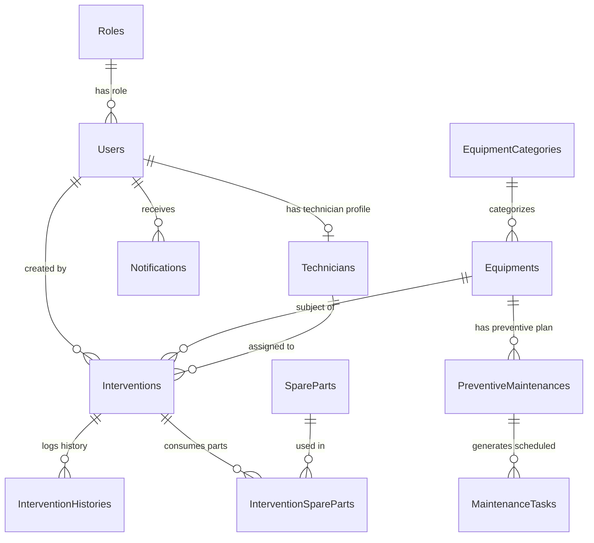

# 📄 SmartMaintenance — Comprehensive Technical & Domain Analysis Report

> **Target Audience:** Autonomous AI Agents, Lead Software Architects, and Full-Stack Developers  
> **Repository:** `ayoubrks/gestion-intervention`  
> **Generated Date:** August 16, 2026  
> **Status:** Production-Ready Clean Architecture (.NET 9 + React 18)

---

## 1. 📌 Executive Overview & Domain Problematic

### 1.1 The Business Problem: Industrial Maintenance Management (GMAO)
In modern manufacturing and industrial facilities, unmanaged equipment downtime directly translates to severe financial loss, safety hazards, and operational bottlenecks. **SmartMaintenance** is a specialized Computerized Maintenance Management System (GMAO — *Gestion de Maintenance Assistée par Ordinateur*) designed to solve the core challenges of industrial asset care:

1. **Unplanned Downtime (Curative Interventions):** Machine failures require rapid reporting, triage, technician assignment, and resolution tracking.
2. **Preventive Maintenance Deficit:** Without scheduled maintenance cycles (lubrication, inspection, filter replacements), machinery degrades exponentially.
3. **Stock Rupture & Spare Part Tracking:** Maintenance delays often occur because replacement parts (gaskets, belts, filters) are out of stock when an emergency occurs.
4. **Lack of Traceability & Compliance:** Regulatory and safety standards demand full historical auditing of who performed work, what actions were taken, which parts were used, and lock-out/tag-out (LOTO) safety protocols.
5. **Technician Workload Balancing:** Dispatchers need real-time insight into technician availability, specialization, and current active tickets.

---

## 2. 🏗️ Architectural System Blueprint & Stack Breakdown

The project follows a **decoupled Client-Server Architecture** adhering strictly to **Clean Architecture** principles on the backend and modern component-driven SPA design on the frontend.

```
+-----------------------------------------------------------------------+
|                               FRONTEND                                |
|                        React 18 + Vite (SPA)                          |
|             Axios / React Router v7 / Lucide Icons / React Toastify    |
+-----------------------------------++----------------------------------+
                                    ||  HTTP / REST API (JSON + JWT)
                                    \/
+-----------------------------------------------------------------------+
|                            BACKEND (API)                              |
|              SmartMaintenance.Api (.NET 9 Web API)                    |
|                JWT Bearer Auth / Swagger / CORS / Seeder              |
+-----------------------------------++----------------------------------+
                                    ||
                                    \/
+-----------------------------------------------------------------------+
|                         APPLICATION LAYER                             |
|               SmartMaintenance.Application (.NET 9)                   |
|                   Interfaces / DTOs / DependencyInjection             |
+-----------------------------------++----------------------------------+
                                    ||
                                    \/
+-----------------------------------------------------------------------+
|                        INFRASTRUCTURE LAYER                           |
|             SmartMaintenance.Infrastructure (.NET 9)                  |
|          EF Core 9 / PostgreSQL / Repositories / AI Engine            |
+-----------------------------------++----------------------------------+
                                    ||
                                    \/
+-----------------------------------------------------------------------+
|                            DOMAIN LAYER                               |
|                  SmartMaintenance.Domain (.NET 9)                     |
|                 Entities / Value Objects / Domain Models              |
+-----------------------------------------------------------------------+
```

### 2.1 Technology Stack Matrix

| Layer | Component | Version / Specification | Role & Responsibilities |
|---|---|---|---|
| **Backend API** | ASP.NET Core Web API | .NET 9.0 | Controllers, JWT Auth handler, CORS policies, Swagger OpenAPI endpoints |
| **Application Layer** | C# Class Library | .NET 9.0 | Application DTOs, Service Contracts (`IInterventionService`, etc.), DI extensions |
| **Infrastructure Layer**| Entity Framework Core 9 | PostgreSQL Driver (`Npgsql`) | Database mapping, migrations, repositories, DbSeeder, AI engine integration |
| **Domain Layer** | C# Class Library | .NET 9.0 | Core domain entities (`Intervention`, `Equipment`, `SparePart`, `User`) |
| **Frontend SPA** | React 18 + Vite | Node v18+ | Kanban UI, Dashboard, Data tables, Conversational AI Chatbot |
| **Database** | PostgreSQL | 14+ | Relational data persistence, foreign key constraints, indexes |
| **Authentication** | JWT (JSON Web Tokens) | `System.IdentityModel.Tokens.Jwt` | Stateless RBAC (Admin, Technician) authentication |
| **AI Assistant** | Hybrid OpenAI / Expert System | GPT-3.5-Turbo + Offline KB | Failure diagnostics, LOTO safety guidelines, step-by-step interactive wizards |

---

## 3. 📁 Complete Codebase Directory & File Inventory Map

Below is the absolute file-by-file breakdown of the repository.

```
gestion-intervention/
├── README.md                                    # Root user guide & quickstart documentation
├── PROJECT_ANALYSIS_REPORT.md                   # [THIS REPORT] Comprehensive AI-agent blueprint
├── SmartMaintenanceAI/                          # 🟢 ACTIVE PRODUCTION BACKEND (.NET 9 Clean Architecture)
│   ├── SmartMaintenanceAI.slnx                  # Solution file for .NET IDEs
│   │
│   ├── SmartMaintenance.Domain/                 # Core Entities & Domain Models
│   │   ├── Entities/
│   │   │   ├── AuditLog.cs                      # System change audit log entity
│   │   │   ├── Equipment.cs                     # Industrial machine / asset entity
│   │   │   ├── EquipmentCategory.cs             # Categorization (Hydraulic, Electrical, Mechanical)
│   │   │   ├── Intervention.cs                  # Curative/preventive intervention work order
│   │   │   ├── InterventionHistory.cs           # Status change audit trail for work orders
│   │   │   ├── InterventionSparePart.cs         # Junction entity for N:M parts usage in interventions
│   │   │   ├── MaintenanceTask.cs               # Specific task instances generated by preventive plans
│   │   │   ├── Notification.cs                  # System alert notifications for users
│   │   │   ├── PreventiveMaintenance.cs         # Scheduled maintenance master plans
│   │   │   ├── Role.cs                          # RBAC User Roles (Admin, Technician)
│   │   │   ├── SparePart.cs                     # Inventory item with stock thresholds & unit costs
│   │   │   ├── Technician.cs                    # Specialization & availability profile linked to User
│   │   │   └── User.cs                          # Identity user account credentials & role link
│   │   └── SmartMaintenance.Domain.csproj
│   │
│   ├── SmartMaintenance.Application/            # DTOs, Interfaces & Service Contracts
│   │   ├── DependencyInjection.cs               # Application layer service registration
│   │   ├── Interfaces/
│   │   │   ├── IAiService.cs                    # Intelligent Assistant service interface
│   │   │   ├── IAuthService.cs                  # Token generation & login logic interface
│   │   │   ├── IEquipmentService.cs             # Equipment CRUD & status management contract
│   │   │   ├── IInterventionService.cs          # Work order lifecycle contract
│   │   │   ├── IPreventiveMaintenanceService.cs # Schedule & task generation contract
│   │   │   ├── ISparePartService.cs             # Inventory & stock adjustment contract
│   │   │   ├── IStatisticsService.cs            # Analytics, MTTR calculation & AI synthesis contract
│   │   │   ├── IUserRepository.cs               # User persistence repository contract
│   │   │   └── IUserService.cs                  # User management business logic contract
│   │   ├── DTOs/
│   │   │   ├── Auth/                            # LoginRequestDto, LoginResponseDto, RegisterDto
│   │   │   ├── Common/                          # PagedResultDto
│   │   │   ├── Equipments/                      # Create/Update/EquipmentDto
│   │   │   ├── Interventions/                   # Create/Update/Assign/Complete/InterventionDto
│   │   │   ├── PreventiveMaintenance/           # Create/Update/PreventiveMaintenanceDto
│   │   │   ├── SpareParts/                      # Create/Update/SparePartDto
│   │   │   └── Users/                           # UserDto, CreateUserDto, UpdateUserDto
│   │   └── SmartMaintenance.Application.csproj
│   │
│   ├── SmartMaintenance.Infrastructure/         # EF Core, Repositories, Database Context & External Services
│   │   ├── DependencyInjection.cs               # DBContext, Repositories, Services & HttpClient setup
│   │   ├── Data/
│   │   │   ├── AppDbContext.cs                  # EF Core DBContext with Fluent API mappings
│   │   │   └── DbSeeder.cs                      # Automated database seed generator
│   │   ├── Repositories/
│   │   │   └── UserRepository.cs                # User EF Core repository implementation
│   │   ├── Services/
│   │   │   ├── AiService.cs                     # Dual-mode AI assistant (OpenAI + Fallback Knowledge Base)
│   │   │   ├── AuthService.cs                  # JWT token generator & SHA-256 password hash validator
│   │   │   ├── EquipmentService.cs              # Equipment business logic & query handlers
│   │   │   ├── InterventionService.cs           # State machine logic, inventory deduction & history logging
│   │   │   ├── PreventiveMaintenanceService.cs  # Maintenance task calculator & recurrence engine
│   │   │   ├── SparePartService.cs              # Stock management & reorder alert thresholds
│   │   │   ├── StatisticsService.cs             # KPI calculator (MTTR, Success Rate, Cost Totals)
│   │   │   └── UserService.cs                  # User CRUD & profile link manager
│   │   ├── Migrations/                          # EF Core PostgreSQL migration scripts
│   │   └── SmartMaintenance.Infrastructure.csproj
│   │
│   └── SmartMaintenance.Api/                    # ASP.NET Core Web API Host
│       ├── Program.cs                           # App startup, JWT configuration, CORS policy, Seeder trigger
│       ├── appsettings.json                     # DB Connection string, JWT secret, OpenAI API key
│       ├── Controllers/
│       │   ├── AiController.cs                  # Endpoint: POST /api/ai/chat
│       │   ├── AuthController.cs                # Endpoints: POST /api/auth/login, /register, GET /me
│       │   ├── EquipmentsController.cs          # Endpoints: GET, POST, PUT, DELETE /api/equipments
│       │   ├── InterventionsController.cs        # Endpoints: CRUD + /assign, /start, /complete, /cancel, /history
│       │   ├── NotificationsController.cs       # Endpoints: GET, PUT /api/notifications
│       │   ├── PreventiveMaintenancesController.cs # Endpoints: CRUD /api/preventivemaintenances
│       │   ├── SeedController.cs                # Endpoint: POST /api/seed (re-trigger seeder)
│       │   ├── SparePartsController.cs          # Endpoints: CRUD + /adjust-stock /api/spareparts
│       │   ├── StatisticsController.cs          # Endpoints: GET /api/statistics/dashboard, /ai-synthesis
│       │   └── UsersController.cs               # Endpoints: GET, POST, PUT, DELETE /api/users
│       └── SmartMaintenance.Api.csproj
│
├── frontend/                                    # 🟢 REACT 18 + VITE FRONTEND
│   ├── package.json                             # Dependencies: react, vite, axios, react-router-dom, react-toastify
│   ├── index.html                               # HTML root shell
│   ├── src/
│   │   ├── main.jsx                             # Application mounting point
│   │   ├── App.jsx                              # Route declarations & ProtectedRoute wrappers
│   │   ├── index.css                            # Complete Design System tokens, CSS variables & global utility styles
│   │   ├── context/
│   │   │   └── AuthContext.jsx                  # React Context managing JWT token, user session & auth state
│   │   ├── services/
│   │   │   ├── api.js                           # Axios instance with Request Interceptor for Bearer JWT token
│   │   │   ├── aiService.js                     # API client for AI chatbot endpoint
│   │   │   ├── authService.js                   # API client for authentication endpoints
│   │   │   ├── equipmentService.js              # API client for equipment endpoints
│   │   │   ├── interventionService.js           # API client for intervention endpoints
│   │   │   ├── notificationService.js          # API client for notification endpoints
│   │   │   ├── preventiveService.js            # API client for preventive maintenance endpoints
│   │   │   ├── sparePartService.js              # API client for spare parts endpoints
│   │   │   ├── statisticsService.js             # API client for dashboard metrics endpoints
│   │   │   └── userService.js                  # API client for user management endpoints
│   │   ├── components/
│   │   │   ├── Chatbot/
│   │   │   │   ├── Chatbot.jsx                  # Floating AI Assistant widget with multi-step interactive forms
│   │   │   │   └── Chatbot.css                  # Chatbot UI styling & animations
│   │   │   ├── Layout/
│   │   │   │   ├── BaseLayout.jsx               # Layout wrapper with Header & Sidebar
│   │   │   │   ├── Header.jsx & Header.css      # Top navigation header with notifications dropdown & user profile
│   │   │   │   └── Sidebar.jsx & Sidebar.css    # Left sidebar navigation with role-based links
│   │   │   ├── ConfirmModal.jsx & .css          # Reusable confirmation modal dialog
│   │   │   ├── InterventionCard.jsx             # Card component rendered in Kanban columns
│   │   │   └── InterventionForm.jsx             # Modal form for creating/editing interventions
│   │   └── pages/
│   │       ├── Dashboard.jsx & .css             # Real-time metrics overview, KPI widgets, AI health insights
│   │       ├── Interventions.jsx & .css         # Interactive Kanban drag-and-drop board + Table view switcher
│   │       ├── Equipments.jsx & .css            # Industrial machinery catalogue with status tags & filters
│   │       ├── SpareParts.jsx & .css            # Inventory management, stock level progress bars & reorder alerts
│   │       ├── Preventive.jsx & .css            # Scheduled maintenance timeline & task execution controls
│   │       ├── Users.jsx                        # User account directory & technician profile assignments
│   │       ├── Settings.jsx & .css              # System configuration & notification preferences
│   │       ├── Login.jsx & .css                 # User login authentication page
│   │       └── Register.jsx & .css              # Account registration page
```

---

## 4. 🗄️ Database Schema, Entity Models & Relational Blueprint

The database is built on **PostgreSQL** via EF Core 9 Code-First migrations with Fluent API relationship mapping (`AppDbContext.cs`).



### 4.1 Field-Level Entity Specifications

#### 1. `User` (`SmartMaintenance.Domain.Entities.User`)
* **`Id`** (`int`, PK): Unique user ID.
* **`Username`** (`string`): Account handle.
* **`Email`** (`string`): Unique user email.
* **`PasswordHash`** (`string`): Base64 SHA-256 hashed password.
* **`RoleId`** (`int`, FK -> `Role.Id`): Assigned system role.
* **`TechnicianProfile`** (`Technician?`): Navigation property to 1:1 technician profile.

#### 2. `Technician` (`SmartMaintenance.Domain.Entities.Technician`)
* **`Id`** (`int`, PK): Unique technician profile ID.
* **`UserId`** (`int`, FK -> `User.Id`, Unique): 1:1 link to User account.
* **`Specialization`** (`string`): E.g., *"Hydraulique & Mécanique"*, *"Électrique & Automatisme"*.
* **`IsAvailable`** (`bool`): Active availability status for work order dispatcher.

#### 3. `Equipment` (`SmartMaintenance.Domain.Entities.Equipment`)
* **`Id`** (`int`, PK): Asset identifier.
* **`Name`** (`string`): Machine name (e.g., *"Pompe Hydraulique P-200"*).
* **`SerialNumber`** (`string`): Manufacturer serial key.
* **`Description`** (`string`): Operational specifications.
* **`Location`** (`string`): Factory location (e.g., *"Atelier A - Zone 1"*).
* **`Status`** (`string`): Values: `"Operational"`, `"UnderMaintenance"`, `"Broken"`.
* **`InstallationDate`** / **`LastMaintenanceDate`** (`DateTime?`): Lifecycle timestamps.
* **`CategoryId`** (`int`, FK -> `EquipmentCategory.Id`).

#### 4. `Intervention` (`SmartMaintenance.Domain.Entities.Intervention`)
* **`Id`** (`int`, PK): Work order ID.
* **`Title`** (`string`): Intervention subject.
* **`Description`** (`string`): Issue description and symptoms.
* **`Status`** (`string`): State machine states: `"Pending"` -> `"Assigned"` -> `"InProgress"` -> `"Completed"` / `"Cancelled"`.
* **`Priority`** (`string`): Severity rating: `"Low"`, `"Normal"`, `"High"`, `"Critical"`.
* **`PlannedDate`** / **`CompletedAt`** (`DateTime?`): Scheduling timestamps.
* **`EstimatedDurationMinutes`** / **`ActualDurationMinutes`** (`int?`): Time tracking for MTTR.
* **`Report`** (`string?`): Technician resolution summary upon completion.
* **`EquipmentId`** (`int`, FK -> `Equipment.Id`).
* **`TechnicianId`** (`int?`, FK -> `Technician.Id`, OnDelete: `SetNull`).
* **`CreatedByUserId`** (`int`, FK -> `User.Id`, OnDelete: `Restrict`).

#### 5. `InterventionSparePart` (`SmartMaintenance.Domain.Entities.InterventionSparePart`)
* **Composite Primary Key:** (`InterventionId`, `SparePartId`).
* **`QuantityUsed`** (`int`): Count of parts consumed during intervention.

#### 6. `SparePart` (`SmartMaintenance.Domain.Entities.SparePart`)
* **`Id`** (`int`, PK): Part ID.
* **`Name`** (`string`): Part designation (e.g., *"Filtre à Huile Haute Pression"*).
* **`Reference`** (`string`): Industry reference code (e.g., `"REF-FHP-101"`).
* **`UnitCost`** (`decimal`): Cost per unit for financial metrics.
* **`StockQuantity`** (`int`): Current quantity in storage.
* **`MinimumThreshold`** (`int`): Low stock alert trigger level.

#### 7. `PreventiveMaintenance` (`SmartMaintenance.Domain.Entities.PreventiveMaintenance`)
* **`Id`** (`int`, PK): Master schedule ID.
* **`Title`** (`string`): Routine activity title.
* **`FrequencyDays`** (`int`): Recurrence interval (e.g., 30, 90, 365 days).
* **`NextDueDate`** (`DateTime`): Next execution deadline.
* **`EquipmentId`** (`int`, FK -> `Equipment.Id`).

---

## 5. ⚡ Backend API Endpoints & Request/Response Flow

All endpoints are hosted on `SmartMaintenance.Api` (`http://localhost:5000`) and require a JWT token in the `Authorization: Bearer <token>` header (except `/api/auth/login` and `/api/auth/register`).

### 5.1 Authentication Controller (`/api/auth`)
* `POST /api/auth/login`: Authenticates credentials, returns JWT token and user info DTO.
* `POST /api/auth/register`: Creates new user account.
* `GET /api/auth/me`: Validates token and returns current user context.

### 5.2 Interventions Controller (`/api/interventions`)
* `GET /api/interventions`: Returns paginated list with optional query filters (`page`, `pageSize`, `search`, `status`, `priority`, `equipmentId`, `technicianId`).
* `GET /api/interventions/{id}`: Returns full details including consumed spare parts and history.
* `POST /api/interventions`: `[Authorize(Roles = "Admin")]` Creates new work order in `"Pending"` state.
* `PUT /api/interventions/{id}`: `[Authorize(Roles = "Admin")]` Updates title, description, or priority.
* `DELETE /api/interventions/{id}`: `[Authorize]` Removes intervention.
* `POST /api/interventions/{id}/assign`: `[Authorize(Roles = "Admin")]` Assigns technician ID and transitions status to `"Assigned"`.
* `POST /api/interventions/{id}/start`: `[Authorize(Roles = "Admin,Technician")]` Transitions status from `"Assigned"` to `"InProgress"`.
* `POST /api/interventions/{id}/complete`: `[Authorize(Roles = "Admin,Technician")]` Completes intervention, records `ActualDurationMinutes`, saves `Report`, and automatically deducts specified `SparePartsUsed` from `SparePart.StockQuantity`.
* `POST /api/interventions/{id}/cancel`: `[Authorize(Roles = "Admin")]` Cancels work order with audit reason.
* `GET /api/interventions/{id}/history`: Returns history audit timeline.

### 5.3 Equipment Controller (`/api/equipments`)
* `GET /api/equipments`: Returns equipment catalogue with category info.
* `POST /api/equipments`: Adds new industrial asset.
* `PUT /api/equipments/{id}`: Updates equipment status or location.
* `DELETE /api/equipments/{id}`: Deletes equipment asset.

### 5.4 Spare Parts Controller (`/api/spareparts`)
* `GET /api/spareparts`: Returns inventory list with low stock flag (`StockQuantity <= MinimumThreshold`).
* `POST /api/spareparts`: Registers new spare part.
* `POST /api/spareparts/{id}/adjust-stock`: Adjusts inventory count (+/- quantity).

### 5.5 Statistics Controller (`/api/statistics`)
* `GET /api/statistics/dashboard`: Computes MTTR, preventive success rate, low stock item count, total spare parts expenditure, and status distribution counts.
* `GET /api/statistics/ai-synthesis`: Returns high-level executive health summary with automated diagnostic recommendations.

### 5.6 Intelligent Assistant Controller (`/api/ai`)
* `POST /api/ai/chat`: Accepts JSON `{ "message": "string" }` and returns intelligent assistant advice.

---

## 6. 🤖 AI Assistant Infrastructure & Multi-Step Conversational Engine

The AI integration in SmartMaintenance is designed to operate seamlessly in both online cloud environments and offline air-gapped industrial facilities via a **Dual-Engine Architecture** (`AiService.cs`).

```
                              User Chat Input
                                     │
                                     ▼
                       Has OpenAI Key configured?
                                ╱         ╲
                              YES          NO (Fallback)
                              ╱             ╲
                             ▼               ▼
                   OpenAI GPT-3.5 API   Local Deterministic
                   (Online LLM mode)    Expert System
                                             │
                                   ┌─────────┴─────────┐
                                   │  Exact KB Match   │
                                   └─────────┬─────────┘
                                             │
                                   ┌─────────┴─────────┐
                                   │ Keyword Scorer    │
                                   │ (Pump, Motor, etc)│
                                   └───────────────────┘
```

### 6.1 Backend AI Engine (`AiService.cs`)
1. **Cloud Mode (OpenAI):** If `AI:OpenApiKey` is present in `appsettings.json`, the API sends the message to `https://api.openai.com/v1/chat/completions` using the `gpt-3.5-turbo` model with system instructions targeting industrial maintenance troubleshooting.
2. **Offline Expert System Mode:** If no key is configured, `AiService.cs` executes a scoring algorithm against an internal domain knowledge base containing detailed troubleshooting rules for:
   * **Hydraulic Pump Overheating:** Step-by-step diagnostic guide & LOTO warning.
   * **Electric Motor Vibration:** Alignment, bearing noise inspection, voltage tolerance checks.
   * **Air Compressor Pressure Drop:** Air circuit leak inspection & preventive oil change rules.
   * **Belt & Seal Replacement:** Component reference guidelines (e.g., `REF-CRR-303`, `REF-JNT-202`) and step-by-step repair guides.
   * **Safety & PPE (LOTO):** Electrical, mechanical, hydraulic lockout/tagout safety protocols.

### 6.2 Frontend Multi-Step Interactive Conversational Engine (`Chatbot.jsx`)
In addition to plain-text Q&A, the React Chatbot (`frontend/src/components/Chatbot/Chatbot.jsx`) features **Interactive Step-by-Step Action Wizards** that allow users to create system entities directly inside the chat interface without opening forms!

* **Intervention Wizard (5 Steps):** Title -> Description -> Priority Selector -> Dynamic Equipment Selector -> Planned Date.
* **Preventive Maintenance Wizard (5 Steps):** Title -> Description -> Frequency (7, 30, 90, 180, 365 days) -> Equipment Selector -> First Due Date.
* **Spare Part Creation Wizard (6 Steps):** Name -> Reference -> Description -> Unit Cost -> Initial Stock -> Minimum Threshold.

---

## 7. 🎨 Frontend Architecture, Routing & UI Components

The React SPA frontend (`frontend/`) is engineered with **Vanilla CSS Design Tokens** (`index.css`) featuring glassmorphism, responsive sidebar navigation, dark mode support, and real-time toast feedback (`react-toastify`).

```
App.jsx (React Router v7)
 ├── /login ─── Login.jsx
 ├── /register ─── Register.jsx
 └── ProtectedRoute (AuthContext)
      └── BaseLayout.jsx
           ├── Header.jsx (User menu, Notification dropdown)
           ├── Sidebar.jsx (Role-aware navigation links)
           ├── Chatbot.jsx (Floating AI assistant widget)
           └── Page Views:
                ├── / ─── Dashboard.jsx
                ├── /interventions ─── Interventions.jsx (Kanban & Table Views)
                ├── /equipments ─── Equipments.jsx
                ├── /spare-parts ─── SpareParts.jsx
                ├── /preventive ─── Preventive.jsx
                ├── /users ─── Users.jsx
                └── /settings ─── Settings.jsx
```

### 7.1 Key Frontend Features & UI Pages

1. **Interactive Kanban Board (`Interventions.jsx`):**
   * Displays work orders in 4 status columns: **Pending** (En attente), **Assigned** (Assigné), **In Progress** (En cours), **Completed** (Terminé / Annulé).
   * Supports view switching between **Kanban Drag/Column View** and **Data Table View**.
   * Role-gated buttons (Only Admins can assign or create; Technicians can start or complete).

2. **Executive Dashboard (`Dashboard.jsx`):**
   * Metrics Cards: Total Assets, Active Interventions, MTTR (Mean Time To Repair in minutes), Preventive Compliance Rate (%), Low Stock Alerts count.
   * Visual Charts: Intervention status breakdown bars, recent activity log, and automated AI Health Insights recommendations.

3. **Stock Control Matrix (`SpareParts.jsx`):**
   * Displays reference code, unit price, current stock level, and minimum threshold.
   * Dynamic progress bar indicating stock health (Green = Good, Red/Warning = Low Stock).
   * Direct stock adjustment modal (+ / - units).

4. **Preventive Schedule Calendar (`Preventive.jsx`):**
   * Master plan creation and recurring task execution control.
   * Automated calculated status: `"Up to date"` vs `"Overdue"` based on target due date vs current date.

---

## 8. 🔄 Business Workflows & State Transition Rules

### 8.1 Intervention Lifecycle State Machine

```
      [ Admin Creates ]
              │
              ▼
        ┌──────────┐
        │ Pending  │
        └────┬─────┘
             │
             │ [ Admin Assigns Technician ]
             ▼
        ┌──────────┐
        │ Assigned │
        └────┬─────┘
             │
             │ [ Technician / Admin Clicks "Start" ]
             ▼
        ┌────────────┐
        │ InProgress │
        └────┬───────┘
             │
             ├─────────────────────────────────────────┐
             │ [ Technician Completes ]                │ [ Admin Cancels ]
             ▼                                         ▼
      ┌───────────┐                             ┌───────────┐
      │ Completed │                             │ Cancelled │
      └───────────┘                             └───────────┘
```

#### State Transition Logic & Side Effects:
1. **Creation (`Pending`):**
   * Work order created by Admin. No technician assigned yet.
   * Log entry added to `InterventionHistory`.
2. **Assignment (`Assigned`):**
   * Admin selects a `TechnicianId`.
   * Status transitions to `"Assigned"`.
   * Notification entity created in database for target technician.
3. **Execution Start (`InProgress`):**
   * Technician clicks **"Démarrer"**.
   * Status transitions to `"InProgress"`.
4. **Completion (`Completed`):**
   * Technician submits resolution report (`Report`), actual duration (`ActualDurationMinutes`), and list of parts used (`SparePartsUsed`).
   * For every consumed part, `SparePart.StockQuantity` is automatically decremented.
   * If stock falls below `MinimumThreshold`, system logs low-stock notification.
   * Equipment `LastMaintenanceDate` is updated to current timestamp.

---

## 9. 🚀 Operational Developer Guide, Environment Setup & Database Seeding

### 9.1 Prerequisites
* [.NET 9.0 SDK](https://dotnet.microsoft.com/download/dotnet/9.0)
* [Node.js (v18+)](https://nodejs.org/)
* [PostgreSQL Database Server](https://www.postgresql.org/)

### 9.2 Step-by-Step Launch Procedure

#### Step 1: Database Connection Configuration
Open `SmartMaintenanceAI/SmartMaintenance.Api/appsettings.json` and adjust credentials:
```json
"ConnectionStrings": {
  "DefaultConnection": "Host=localhost;Database=SmartMaintenanceDB;Username=postgres;Password=YOUR_PASSWORD"
}
```

#### Step 2: EF Core Database Creation & Migration
Open terminal in repository root:
```bash
cd SmartMaintenanceAI
dotnet ef database update --project SmartMaintenance.Infrastructure --startup-project SmartMaintenance.Api
```

#### Step 3: Start ASP.NET Core API Backend
```bash
cd SmartMaintenanceAI/SmartMaintenance.Api
dotnet run
```
* API Server will listen at: `http://localhost:5000`
* Swagger OpenAPI Documentation: `http://localhost:5000/swagger`

#### Step 4: Start React Frontend
In a separate terminal:
```bash
cd frontend
npm install
npm run dev
```
* React Web Application accessible at: `http://localhost:5173`

### 9.3 Default Test Accounts (`DbSeeder.cs`)

Upon initial API startup, `DbSeeder.cs` automatically provisions the database with initial categories, equipment assets, spare parts, and seed users:

| System Role | Email Address | Password | Privileges & Access |
|---|---|---|---|
| **System Admin** | `admin@smartmaintenance.com` | `Admin123!` | Full admin access: create/assign/edit/delete interventions, equipment management, user administration |
| **Technician 1** | `tech1@smartmaintenance.com` | `Tech123!` | Technician access: view assigned tasks, start & complete interventions, execute preventive tasks |
| **Technician 2** | `tech2@smartmaintenance.com` | `Tech123!` | Technician access: view assigned tasks, electrical & automation specialization |

---

## 10. ⚠️ Legacy Migration Analysis (`backend_old` vs `SmartMaintenanceAI`)

### 10.1 Why `backend_old` Was Replaced
The repository originally contained a single monolithic project structure in `backend_old/`. This legacy implementation had significant drawbacks:
* Tight coupling between database controllers, entities, and business logic.
* Difficulty extending features (such as AI integrations, MTTR analytics, and inventory deduction hooks).
* Inability to run clean unit tests on business logic independent of the web API context.

### 10.2 Modern Architecture Advantages (`SmartMaintenanceAI/`)
The current architecture in `SmartMaintenanceAI/` resolves these issues:
* **Separation of Concerns:** Strict layer boundary (`Domain` -> `Application` -> `Infrastructure` -> `Api`).
* **Maintainability:** Adding a new feature (e.g., IoT sensor telemetry or automated email notifications) requires only adding a contract in `Application` and implementation in `Infrastructure`.
* **Security:** JWT authentication logic and password hashing are cleanly isolated in `AuthService.cs`.

---

## 11. 🎯 Summary for AI Agents

When acting on or extending this repository, AI agents must adhere to the following rules:

1. **Do NOT touch `backend_old/`:** It is archived and deprecated.
2. **Backend Edits Location:** All backend modifications belong inside `SmartMaintenanceAI/` in their respective layers (`Domain` for entities, `Application` for DTOs/Interfaces, `Infrastructure` for implementations/DbContext, `Api` for controllers).
3. **Frontend Edits Location:** All client UI modifications belong in `frontend/src/`.
4. **Database Changes:** Always generate an EF Core migration when modifying entities in `SmartMaintenance.Domain/Entities`.
5. **API Security:** All new endpoints modification in `Api/Controllers` must specify appropriate `[Authorize]` or `[Authorize(Roles = "...")]` attributes.

---
*Report compiled successfully for AI Agent context window initialization.*
